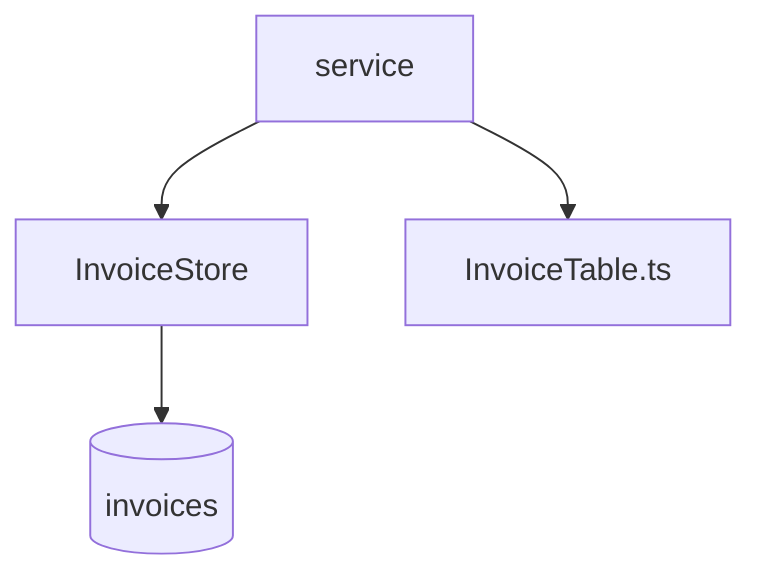

# Invoice store, outstanding balance, paging, search and the invoice table

## Intent
Keep invoices in integer cents, answer "how much does this customer still
owe", page through every invoice, find a customer's invoices by name prefix,
and render them as an HTML table.

## Context
`tally.store.InvoiceStore` owns the `invoices` SQLite table;
`tally.service` holds the use cases; `frontend/src/InvoiceTable.ts` renders
what the service returns. Nothing else touches the table.

## Goals
- G1: amounts are integer cents end to end; no float ever holds money.
- G2: `outstanding(store, customer)` sums the unpaid invoices of one customer.
- G3: `page(store, number, size=10)` returns page `number` (1-based), exactly `size` rows except on the last page.
- G4: `InvoiceStore.search(prefix)` returns the invoices whose customer starts with `prefix`, oldest first.
- G5: `renderInvoiceTable` escapes every customer name.

## Non-Goals
- NG1: no currency other than one implicit currency.
- NG2: no authentication; callers are trusted processes.

## Assumptions
- A1: SQLite 3.35 or later.

## Interface
- `InvoiceStore.add(customer: str, cents: int) -> Invoice`; `ValueError` when `cents <= 0`.
- `InvoiceStore.search(prefix: str) -> list[Invoice]`.
- `page(store, number: int, size: int = 10) -> list[Invoice]`; `ValueError` when `number < 1` or `size < 1`.
- `renderInvoiceTable(invoices: Invoice[]): string`.

## Behavior

### Nominal
Every query binds its values as SQL parameters; no user text is ever
formatted into SQL.

### Edge cases
- A page past the end -> empty list.
- `search("")` -> every invoice.
- A prefix holding `%` or `_` matches those characters literally.

### Failure scenarios
- A non-positive amount -> `ValueError`, nothing written.

## Architecture Impact
- Adds dependency: none.
- New / changed coupling, cycles, or shared state: the `invoices` table, owned here.

## Diagram

## Acceptance Criteria
- [ ] AC1: `pytest -q tests` passes.
- [ ] AC2: 25 invoices, size 10 -> pages of 10, 10, 5, 0; page 2 starts at id 11.
- [ ] AC3: `search("ac")` returns acme's invoices and nothing else; `search("x' OR '1'='1")` returns nothing.
- [ ] AC4: every public function in `src/tally/` and `frontend/src/` has a test.
- [ ] AC5: `cd frontend && npx vitest run` passes.

## Open Questions
